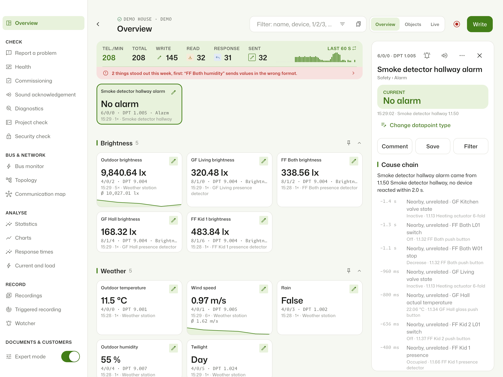

# KNX Monitor

Bus monitor and diagnostics for KNX: a Flutter app for iPhone, iPad, Android,
macOS, Windows, Linux and the browser, a Home Assistant add-on that records the
bus around the clock, and the KNX Box, a Raspberry Pi that records on site.
Everything that speaks KNX is written here in plain Dart: KNXnet/IP tunnelling
and routing, cEMI, KNX IP Secure, KNX Data Secure, the ETS project parser and
an FT1.2 link to the kBerry module. German and English.



- **Website:** <https://knx-monitor.de>
- **Releases, Home Assistant add-on repository, issues:**
  [regetskcob/KNX-Monitor](https://github.com/regetskcob/KNX-Monitor). Bugs,
  ideas and questions go there.
- **Licence:** [GPLv3](LICENSE). Name and logo are not covered, see
  [TRADEMARKS.md](TRADEMARKS.md).

[](https://my.home-assistant.io/redirect/supervisor_add_addon_repository/?repository_url=https%3A%2F%2Fgithub.com%2Fregetskcob%2FKNX-Monitor)

## What it does

| Area | Highlights |
| --- | --- |
| Monitor | Last value per group address with mini history, live list with millisecond timestamps, bus activity, filters, play/pause |
| ETS project | `.knxproj` up to ETS6, also password-protected, or the group address CSV: names, datapoint types, devices, rooms, links |
| Analysis | Priority, repeat flag, hop count, send confirmations; hints for repeated, unacknowledged and unanswered telegrams, wrong data length, unknown senders |
| Health | Silent devices, cycle watchdog, datapoint type check per sender, bus quality, PDF report |
| Commissioning | Read status, find devices in programming mode, check individual addresses, checklist and protocol |
| Expert tools | Bus monitor with raw frames, topology and communication map, delayed and cyclic sending, recordings with replay onto the bus |
| Devices and charts | Actuators drawn as DIN-rail devices with live channel LEDs, charts for several addresses, statistics heatmap |
| Connection | Tunnelling over UDP or TCP, routing, KNX IP Secure, KNX Data Secure with the ETS keyring |
| Home Assistant | Permanent recording, alarms and watchers as notifications and events, MQTT device, blueprints, dashboard card, Prometheus and InfluxDB export, read-only mode |
| KNX Box | Raspberry Pi image with its own Wi-Fi, IP gateway or kBerry on TP, set up from the app |

A demo house is built in, so everything can be tried without a gateway.

Some features of the apps from the App Store and Google Play are part of paid
tiers there. The account with sync between devices, the solution for
electrical contractors and the home planning package are commercial parts of
KNX Monitor and not in this repository; the app builds and runs without them.

## Documentation

Read it in the [wiki](https://github.com/regetskcob/KNX-Monitor-Code/wiki),
or here in [docs/](docs/README.md), where it is written. Start with
[docs/architecture.md](docs/architecture.md).

| Topic | Document |
| --- | --- |
| How the pieces fit together | [architecture.md](docs/architecture.md) |
| Add-on server, permanent recording, protocol to the views | [addon-recording.md](docs/addon-recording.md) |
| KNX Box: image, storage, compression, time, network | [knx-box.md](docs/knx-box.md) |
| kBerry on the Raspberry Pi, FT1.2 and cEMI, reusable | [kberry.md](docs/kberry.md) |
| Encryption, backups, KNX Secure, access, what leaves the device | [security.md](docs/security.md) |
| Backup file format | [backup-format.md](docs/backup-format.md) |
| Home Assistant add-on for users | [DOCS.md](ha-addon/knx_monitor/DOCS.md) |

## Build and run

Requirements: Flutter 3.47 (stable, Dart 3.13), the platform toolchains you
need (Xcode, Android SDK, Visual Studio, or the Linux packages below).

```bash
flutter pub get
flutter run                 # app on a connected device or desktop
flutter test                # unit, widget and golden tests
```

**Linux desktop** (tested on Ubuntu 24.04): install
`clang cmake ninja-build pkg-config libgtk-3-dev liblzma-dev libstdc++-12-dev libsecret-1-dev`,
then `flutter build linux --release`. Differences between the platforms:
[docs/desktop-platforms.md](docs/desktop-platforms.md).

**Add-on server** (Dart, no Flutter):

```bash
flutter build web --release --no-web-resources-cdn   # the UI the server serves
cd ha-addon/knx_monitor/server
dart pub get
dart test
ALLOW_ALL=1 PORT=8766 WEB_DIR=$PWD/../../../build/web DATA_DIR=/tmp/knx-data dart run bin/server.dart
```

`ALLOW_ALL=1` turns off every access check; use it on your own machine only.
It listens on 127.0.0.1, and the server refuses a network `BIND` with it
unless `ALLOW_ALL_EXPOSED=1` is set too (only for throwaway CI containers). To install a local build into Home Assistant:
`tool/build_ha_addon.sh hassio@homeassistant.local` (copies the add-on over
SSH to `/addons`; then **Check for updates** in the add-on store).

**Docker image** (the same as `ghcr.io/regetskcob/knx-monitor`), without a
local Flutter or Dart; the [Dockerfile](Dockerfile) builds web app and server:

```bash
docker build -t knx-monitor --build-arg BUILD_VERSION="$(sed -n 's/^version: "\(.*\)"/\1/p' ha-addon/knx_monitor/config.yaml)" .
```

Then use `image: knx-monitor` in the [compose file](tool/public-repo/docker/compose.yaml).

**KNX Box image:** see [docs/knx-box.md](docs/knx-box.md). **Releases:**
[docs/releasing.md](docs/releasing.md).

**Everything CI checks, in one command:** `tool/release.sh verify` (layout,
translations, format, analysis, tests, box scripts, web build, add-on server,
websites).

## Repository layout

| Folder | Content |
| --- | --- |
| `lib/` | The app: `knx/` protocol (no UI), `model/` state and rules, `platform/` platform specifics, `export/` PDF and other exports, `ui/` screens, `l10n/` texts (German is the template), `theme/` |
| `test/`, `integration_test/` | Unit, widget and golden tests (`test/goldens/`); on-device tours |
| `ha-addon/knx_monitor/` | Home Assistant add-on: Dockerfile, Dart server in `server/`, dashboard card |
| `box/` | KNX Box: setup, systemd units, pi-gen image, printable case (`box/case/`) |
| `third_party/` | Patched plugins, each with `README.vendored.md` |
| `site/` | Website knx-monitor.de (Hugo) |
| `docs/` | Technical documentation, index in [docs/README.md](docs/README.md) |
| `tool/` | Release, deployment and build scripts; `werkbank/` is shared tooling (MIT), `public_source/` builds this public tree |

## Contributing and security

Read [CONTRIBUTING.md](CONTRIBUTING.md) before you open a pull request:
contributions need a short contributor licence agreement. Report security
problems privately as described in [docs/security.md](docs/security.md#reporting-a-vulnerability),
never in a public issue.

## Licence

GNU General Public License v3.0, see [LICENSE](LICENSE). Copyright (C) 2026
Daniel Bocksteger (regetskcob). Versions published before 20 October 2026
were MIT-licensed and remain so. Code from other projects:
[docs/third-party-notices.md](docs/third-party-notices.md).

KNX is a trademark of the KNX Association. This project is not affiliated with
or endorsed by the KNX Association.
