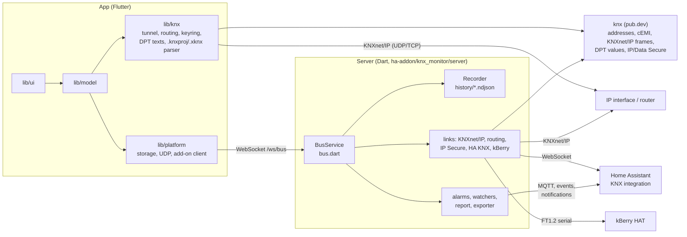

# Architecture

Busclear is one Flutter code base and one small Dart server. The app runs on
iOS, iPadOS, Android, macOS, Windows, Linux and in the browser; the server keeps
a permanent bus connection for the Home Assistant add-on, Docker and the KNX
Box. KNXnet/IP, cEMI, KNX IP Secure, KNX Data Secure and the FT1.2 link to the
kBerry HAT come from our own open-source packages `knx` and `knx_io` on pub.dev
(BSD-3-Clause, github.com/regetskcob/dart-knx, see
[The packages knx and knx_io](#the-packages-knx-and-knx_io)); the ETS project
parser and everything else is implemented here, in plain Dart.

## Two ways to the bus

**Direct.** On phones, tablets and desktops the app opens its own connection to
an IP interface or router: `lib/knx/knx_tunnel.dart` (tunnelling over UDP or
TCP), `routing_tunnel.dart` (multicast routing), `secure_tunnel.dart` (KNX IP
Secure). Telegrams live in memory and in the app's own history while the app
is open.

**Through the server.** In the Home Assistant add-on, in Docker and on the KNX
Box, the server in `ha-addon/knx_monitor/server/` holds the connection around
the clock, records every telegram and runs alarms and watchers even when no
browser is open. Every view (the web app served by the add-on, or a paired
app) attaches through `lib/knx/shared_tunnel.dart`, which looks like any other
tunnel to the rest of the app. Details: [addon-recording.md](addon-recording.md).

## The app

| Folder | What it holds |
| --- | --- |
| `lib/knx/` | Connections and texts on top of `package:knx`: tunnels, routing, bus monitor frames, telegram and datapoint texts (`telegram.dart`, `dpt_codec.dart`), group address catalog (`group_catalog.dart`), ETS project parser (`knxproj_parser.dart`), XKNX Editor project parser (`xknx_parser.dart` on the read-only SQLite reader `sqlite_reader.dart`, see [xknx-editor.md](xknx-editor.md)) |
| `lib/knx/secure/` | ETS keyring (`keyring.dart`, `keyring_store.dart`) and the app's own encryption; the KNX Secure protocol itself is in `package:knx` |
| `lib/model/` | State and rules: the live monitor, history, health check, commissioning, alarms, watchers, installations, backups. Mostly plain classes with a `ChangeNotifier` and one `instance` each |
| `lib/platform/` | Everything that differs per platform: encrypted file storage, UDP, the add-on/box client, keychain, store purchases. Conditional imports pick `*_io.dart` or `*_web.dart` |
| `lib/export/` | PDF, CSV, ETS and Home Assistant exports, diagnostics package |
| `lib/ui/` | Screens and widgets, built on the Horizont design system |
| `lib/l10n/` | German and English texts (`app_de.arb`, `app_en.arb`, generated code) |

The app has no backend dependency: it builds and runs without any server of
ours. The web build (`flutter build web`) is the user interface of the add-on
and the box.

## The server

`bin/server.dart` starts an HTTP server with three faces: Home Assistant
Ingress (add-on), standalone with password (`BOX=1`, Docker and Busclear Box), and
the static web app.

| File | Role |
| --- | --- |
| `bus.dart` | `BusService`: one bus connection per installation, reconnects, shares frames with all views over `/ws/bus`, accepts send requests |
| `link_texts.dart` | German texts for the English errors and labels of `package:knx_io` (tunnelling, routing, FT1.2) |
| `telegram_json.dart`, `dpt_value.dart` | History lines and numeric values, thin adapters over `package:knx` |
| `history_query.dart` | Telegrams of a few addresses over a period, thinned, for the app's charts |
| `ha_link.dart` | Uses the telegrams of Home Assistant's KNX integration instead of an own tunnel |
| `zip_stream.dart` | Writes a zip while it is sent (whole history as ETS files) |
| `ha_history.dart` | Fills gaps in the history from the telegram store of Home Assistant's KNX integration |
| `kberry.dart` | Box-specific part of the kBerry HAT (Pi configuration, check service); the FT1.2 link itself is in `package:knx_io`, see [kberry.md](kberry.md) |
| `read_only.dart`, `cemi_policy.dart` | What may be sent: read-only mode, limits for paired devices |
| `recorder.dart` | Day files `history/YYYY-MM-DD.ndjson`, one JSON line per telegram |
| `alarms.dart`, `watchers.dart`, `report.dart` | The same rules as in the app, evaluated on the server |
| `mqtt_bridge.dart`, `ha.dart`, `lovelace_card.dart` | Home Assistant: MQTT device and entities, events, notifications, dashboard card |
| `exporter.dart`, `grafana.dart` | Prometheus and InfluxDB export, Grafana dashboard |
| `box_*.dart`, `crash_watch.dart` | Busclear Box: access, TLS, clock, printed sheet, crash records |

## The packages knx and knx_io

The KNX protocol code is published as open source (BSD-3-Clause, copyright
Kalkar IT Solutions) in the repository
[regetskcob/dart-knx](https://github.com/regetskcob/dart-knx) and comes from
pub.dev, pinned by `pubspec.lock`. Changes to it go there first, then a new
version here.

| Package | What it holds | Used by |
| --- | --- | --- |
| [`knx`](https://pub.dev/packages/knx) | Group and individual addresses, cEMI L_Data frames, `Telegram` with the history's JSON line format, KNXnet/IP frames, datapoint types and DPT guessing, KNX IP/Data Secure (`package:knx/secure.dart`). No `dart:io`, so it also runs in the web app | app and server |
| [`knx_io`](https://pub.dev/packages/knx_io) | `BusLink` with KNXnet/IP tunnelling (UDP, TCP, IP Secure), routing and FT1.2/kBerry (`Ft12CemiLink`, `KberryProbe`). English error texts with a stable `LinkException.problem` | server |

What stays here: everything with Flutter, texts and translations (the app in
`lib/knx/telegram.dart` and `dpt_codec.dart`, the server in `link_texts.dart`),
storage and app models, keyring parsing and storage, the app's tunnels
(`knx_tunnel.dart`), the box-specific HAT parts (`kberry.dart`), the send
policy (`cemi_policy.dart`), the `.knxproj` parser, and the private parts
listed in `tool/public_source/private.txt`.

## Data

Each installation (home, customer, site) has its own folder with the ETS
catalog, keyring, settings and history. In the apps the files are encrypted
with AES-256-GCM; a full backup is a single password-protected file. The
add-on and the box store plain files and rely on the host. See
[security.md](security.md) and [backup-format.md](backup-format.md).

## Tests

- App: `flutter test` (unit, widget and golden tests in `test/`), integration
  tests in `integration_test/`.
- Packages `knx` and `knx_io`: in their own repository (regetskcob/dart-knx).
- Server: `dart test` in `ha-addon/knx_monitor/server/`, with a fake KNXnet/IP
  gateway (`test/fake_gateway.dart`) and a fake kBerry (`test/fake_kberry.dart`).
- Box: `box/test-firstboot.sh`, `box/test-setup.sh`.
- Everything at once, as in CI: `tool/release.sh verify`.

## Further reading

- [docs/README.md](README.md): index of all documents.
