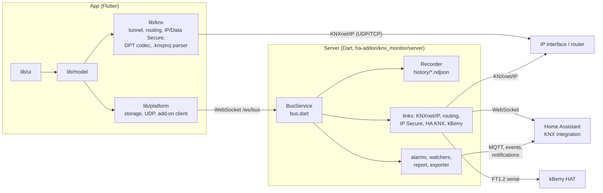

# Architecture

KNX Monitor is one Flutter code base and one small Dart server. The app runs on
iOS, iPadOS, Android, macOS, Windows, Linux and in the browser; the server keeps
a permanent bus connection for the Home Assistant add-on, Docker and the KNX
Box. Neither uses a third-party KNX library: KNXnet/IP, cEMI, KNX IP Secure,
KNX Data Secure, the ETS project parser and the FT1.2 link to the kBerry HAT are
implemented here, in plain Dart.

## Two ways to the bus

**Direct.** On phones, tablets and desktops the app opens its own connection to
an IP interface or router: `lib/knx/knx_tunnel.dart` (tunnelling over UDP or
TCP), `routing_tunnel.dart` (multicast routing), `secure_tunnel.dart` (KNX IP
Secure). Telegrams live in memory and in the app's own history while the app
is open.

**Through the server.** In the Home Assistant add-on, in Docker and on the KNX
Box, the server in `ha-addon/knx_monitor/server/` holds the connection around
the clock, records every telegram and runs alarms and watchers even when no
browser is open. Every view (the web app served by the add-on, or a paired
app) attaches through `lib/knx/shared_tunnel.dart`, which looks like any other
tunnel to the rest of the app. Details: [addon-recording.md](addon-recording.md).

## The app

| Folder | What it holds |
| --- | --- |
| `lib/knx/` | Protocol: cEMI (`cemi.dart`), telegrams (`telegram.dart`), tunnels, bus monitor frames, datapoint types (`dpt_codec.dart`, `dpt_guess.dart`), group address catalog (`group_catalog.dart`), ETS project parser (`knxproj_parser.dart`) |
| `lib/knx/secure/` | KNX Secure: AES-128-CCM building blocks (`knx_crypto.dart`), IP Secure handshake and session (`ip_secure.dart`), Data Secure (`data_secure.dart`), ETS keyring (`keyring.dart`, `keyring_store.dart`) |
| `lib/model/` | State and rules: the live monitor, history, health check, commissioning, alarms, watchers, installations, backups. Mostly plain classes with a `ChangeNotifier` and one `instance` each |
| `lib/platform/` | Everything that differs per platform: encrypted file storage, UDP, the add-on/box client, keychain, store purchases. Conditional imports pick `*_io.dart` or `*_web.dart` |
| `lib/export/` | PDF, CSV, ETS and Home Assistant exports, diagnostics package |
| `lib/ui/` | Screens and widgets, built on the Horizont design system |
| `lib/l10n/` | German and English texts (`app_de.arb`, `app_en.arb`, generated code) |

The app has no backend dependency: it builds and runs without any server of
ours. The web build (`flutter build web`) is the user interface of the add-on
and the box.

## The server

`bin/server.dart` starts an HTTP server with three faces: Home Assistant
Ingress (add-on), standalone with password (`BOX=1`, Docker and KNX Box), and
the static web app.

| File | Role |
| --- | --- |
| `bus.dart` | `BusService`: one bus connection per installation, reconnects, shares frames with all views over `/ws/bus`, accepts send requests |
| `link.dart`, `knxip.dart` | KNXnet/IP tunnelling and routing, `BusLink` interface |
| `secure/` | KNX IP Secure session and Data Secure for the server |
| `ha_link.dart` | Uses the telegrams of Home Assistant's KNX integration instead of an own tunnel |
| `ft12.dart`, `ft12_link.dart`, `kberry.dart` | Serial link to the kBerry HAT, see [kberry.md](kberry.md) |
| `read_only.dart`, `cemi_policy.dart` | What may be sent: read-only mode, limits for paired devices |
| `recorder.dart` | Day files `history/YYYY-MM-DD.ndjson`, one JSON line per telegram |
| `alarms.dart`, `watchers.dart`, `report.dart` | The same rules as in the app, evaluated on the server |
| `mqtt_bridge.dart`, `ha.dart`, `lovelace_card.dart` | Home Assistant: MQTT device and entities, events, notifications, dashboard card |
| `exporter.dart`, `grafana.dart` | Prometheus and InfluxDB export, Grafana dashboard |
| `box_*.dart`, `crash_watch.dart` | KNX Box: access, TLS, clock, printed sheet, crash records |

## Data

Each installation (home, customer, site) has its own folder with the ETS
catalog, keyring, settings and history. In the apps the files are encrypted
with AES-256-GCM; a full backup is a single password-protected file. The
add-on and the box store plain files and rely on the host. See
[security.md](security.md) and [backup-format.md](backup-format.md).

## Tests

- App: `flutter test` (unit, widget and golden tests in `test/`), integration
  tests in `integration_test/`.
- Server: `dart test` in `ha-addon/knx_monitor/server/`, with a fake KNXnet/IP
  gateway (`test/fake_gateway.dart`) and a fake kBerry (`test/fake_kberry.dart`).
- Box: `box/test-firstboot.sh`, `box/test-setup.sh`.
- Everything at once, as in CI: `tool/release.sh verify`.

## Further reading

- [docs/README.md](README.md): index of all documents.
